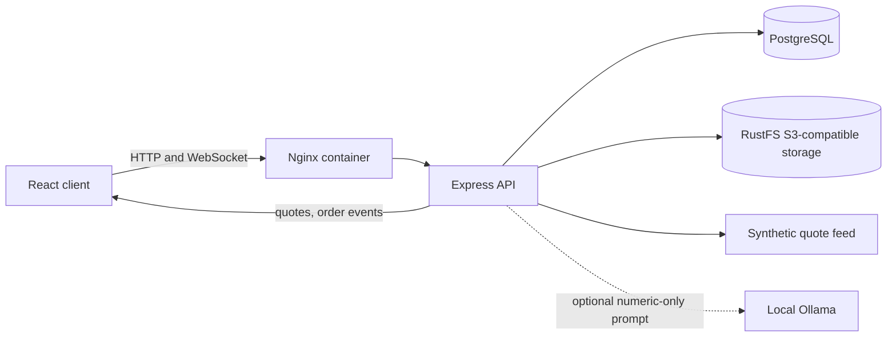
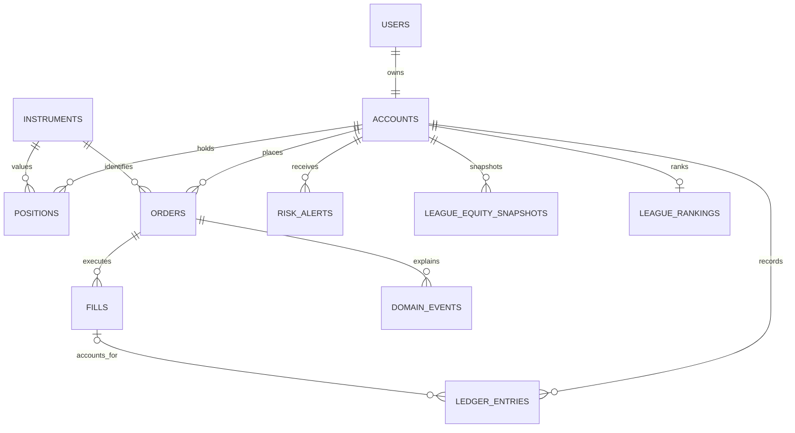

# TradeWise

TradeWise is a paper-trading simulator. All balances and trades are virtual; it does not connect to a broker or place real orders. The local quote feed is synthetic and exists for development and learning.

## Requirements

- Node.js 20.19 or newer and npm
- Docker Compose for local PostgreSQL and RustFS S3-compatible storage

## Local setup

```powershell
Copy-Item .env.server.example .env
Copy-Item .env.client.example client/.env
docker compose up --build -d
npm install
```

The Compose stack publishes the client at <http://localhost:5173>, the API at <http://localhost:3000>, the synthetic feed on port 4000, PostgreSQL on port 5433, and RustFS S3-compatible storage on port 9000 (console: 9001). The database uses the persistent `tradewise-postgres` Compose volume and is separate from a Windows PostgreSQL service. Compose deliberately does **not** migrate or seed the database automatically. After the API container is running, initialize only the Compose database when you are ready:

```powershell
docker compose exec api node server/dist/db/migrate.js up
docker compose exec api node server/dist/db/seed.js
```

For the host-based development workflow, start the Compose infrastructure and run `npm run dev`; that starts the API, client, and synthetic feed from the host. Configure the host `DATABASE_URL` for whichever PostgreSQL service you intend to use (`localhost:5432` for a native Windows service or `localhost:5433` for the Compose database). Apply migrations and seed only after confirming the selected database.

The scaffold uses npm workspaces (`shared/`, `server/`, and `client/`). Root scripts include `dev`, `build`, `test`, `lint`, `seed`, `repl`, `demo:modules`, `migrate:up`, `migrate:down`, `candles:generate`, and `candles:import`. The REPL provides `engine` (a DEMO-symbol order book), `bus` (typed domain event bus), and `pool` (PostgreSQL pool) in its context. Run `npm run demo:modules` to see the ESM/CommonJS interoperability example. Migration 002 adds accounts, instruments, candles, fills, ledger, events, risk, and watchlist tables while preserving existing API tables. `npm run migrate:down` rolls back one migration and drops its new trading-domain tables.

New accounts receive **100,000,000 paise (₹1,000,000)** in virtual cash. Local credentials in `.env.server.example` are for development only; set a unique `JWT_SECRET` and service credentials before deployment. Keep `.env` out of version control.

### Google sign-in

Google sign-in is available on the login and registration pages after you configure a Google Identity Services **Web application client ID**. Set the same value as `GOOGLE_CLIENT_ID` in the root `.env` (API verification) and `VITE_GOOGLE_CLIENT_ID` in `client/.env` (Google button), then rebuild/restart the stack with `docker compose up --build -d`. For the Compose setup, the root `GOOGLE_CLIENT_ID` is passed to both services. Add `http://localhost:5173` to the authorized JavaScript origins in Google Cloud for local development. Apply the new database migration with `docker compose exec api node server/dist/db/migrate.js up`. Until a client ID is configured, the Google button is shown as setup-required and cannot be used.

### PostgreSQL password troubleshooting

`password authentication failed` means PostgreSQL rejected the user/password in `DATABASE_URL`; the migration has not run yet. Ensure `DATABASE_URL` uses the same username, password, and database as `POSTGRES_USER`, `POSTGRES_PASSWORD`, and `POSTGRES_DB` in the root `.env`. The checked-in examples use matching local-only defaults.

Compose initializes a database user's password only when its data volume is first created. If you changed `POSTGRES_PASSWORD` after the volume already existed, update the database role password using an existing working database administrator login, or set `DATABASE_URL` to the password already stored in that database. Do not remove the Postgres volume just to fix credentials if it contains data. If the password contains URL-special characters, percent-encode it in `DATABASE_URL`.

## Useful commands

```powershell
npm run typecheck
npm test
npm run build
Invoke-RestMethod http://localhost:3000/api/v1/health
Invoke-RestMethod http://localhost:3000/api/health/database
```

`/api/v1/health` is a liveness check. `/api/health/database` checks the PostgreSQL connection and returns only its status and database name; it returns HTTP 503 when the configured database is unavailable.

Use `npm run migrate:up` to apply pending migrations and `npm run migrate:down` to revert the latest migration. `npm run seed` creates 90 days of synthetic daily candles when the candle table is empty and fills in seven days of synthetic one-minute candles for intraday charts. These candles are generated practice data, not real market history. To import a separate dataset, generate a 90-day CSV with `npm run candles:generate` and import it with `npm run candles:import -- C:\path\to\candles.csv`; the importer streams rows and can be rerun safely.

Interactive API documentation is at <http://localhost:3000/api/docs>.
The hand-maintained OpenAPI 3.1 document is [server/openapi.yaml](./server/openapi.yaml) and is served at <http://localhost:3000/api/docs/openapi.yaml>.

The Bruno collection is in [bruno/TradeWise](./bruno/TradeWise). Open it in Bruno with the **Local** environment. The request sequence for register → login → place order → timeline → replay is described in [Trade-flow.md](./bruno/TradeWise/Flows/Trade-flow.md); avatar upload requests use a replaceable local-file placeholder.

### Docker images and smoke test

`Dockerfile.server` builds the shared package and API/feed runtime; `Dockerfile.client` builds the React app and serves it with Nginx, including SPA and API/WebSocket proxying. `docker compose up --build` starts the full local stack. Migrations and seeding remain explicit commands above; verify the database target before applying them.

The end-to-end smoke test is restricted to a database named `tradewise_test`. Prepare that dedicated database with migrations and seed data, then run:

```powershell
$env:SMOKE_DATABASE_URL = "postgresql://<user>:<encoded-password>@localhost:5432/tradewise_test"
npm run test:smoke --workspace @tradewise/server
Remove-Item Env:SMOKE_DATABASE_URL
```

The flow registers and logs in a generated user, partially fills an order against the local market maker, cancels its remainder, checks a risk rejection, and verifies the portfolio by replay. It deletes only its generated user and refuses any database whose name is not exactly `tradewise_test`.

## API

- `GET /api/v1/health`
- `POST /api/v1/auth/register`, `POST /api/v1/auth/login`, `GET /api/v1/auth/me`, `POST /api/v1/auth/logout`
- `POST /api/v1/auth/me/avatar` (JPEG, PNG, or WebP; 2 MB maximum; stored in S3-compatible object storage)
- `GET/PATCH /api/v1/users/me`, `PATCH /api/v1/users/me/password`, `POST /api/v1/users/me/reset`, and `POST /api/v1/users/me/avatar`
- `GET /api/quotes` and `GET /api/quotes/ws`
- `GET/POST /api/ai/explain` (authenticated; numeric metrics only; Ollama is optional and the POST endpoint falls back to a deterministic explanation)
- `GET /api/league?limit=20&offset=0` (authenticated, scheduled paginated standings)
- `GET /api/market/quotes`, `GET /api/market/instruments`, `GET /api/market/:symbol`, `GET /api/market/:symbol/candles`, `GET /api/market/:symbol/depth`
- Authenticated watchlist CRUD at `/api/watchlists`, including instrument add/remove routes
- `GET /api/wallet`, `GET /api/portfolio`
- `POST /api/orders`, `GET /api/orders`, `GET /api/trades`
- `GET /api/admin/users` (admin role only)

The protected `/app/markets` workspace provides searchable, sector-filtered instruments, live quotes, watchlist actions, candlestick intervals, aggregated open-order depth, and risk-checked market/limit order tickets.
The protected `/app/orders` workspace supports URL-backed status, side, symbol, and date filters, paginated order history, open-order cancellation, event timelines, and step-by-step cash/holdings replay. Authenticated order WebSocket updates refresh the visible order list.
The protected `/app/portfolio` workspace shows holdings and per-position P&L, stock and sector allocation, performance contributions, paginated ledger activity, a downloadable CSV statement, and ledger-replay verification.
The protected `/app/risk` workspace edits account trading limits, displays concentration gauges and read/unread risk alerts, and previews hypothetical buy/sell concentration through `POST /api/v1/risk/preview` without placing an order.
The protected `/app/profile` workspace edits the display name, uploads a validated avatar, changes the password, and shows account details. It also provides a typed-confirmation reset for the virtual account; reset cancels open orders, clears positions, restores ₹10,00,000 virtual cash, and retains historical trading and ledger records. Administrators can configure the global reset cooldown (initially 24 hours). Migration `009_virtual_account_reset` must be applied before using the profile/reset endpoints.
The dashboard's **Explain my portfolio** card requests a factual explanation of computed equity, return, P&L, and numeric per-holding contributions. `POST /api/ai/explain` can use local Ollama configured with `OLLAMA_BASE_URL` and `OLLAMA_MODEL`; only numeric metrics are sent to the model, output must match a strict JSON schema, and an unavailable model uses a deterministic template. Explanation endpoints are rate limited. Explanations never place or approve orders.
The protected `/app/league` workspace shows paginated standings. A server-side 60-second job snapshots equity and calculates return against contributed capital, maximum drawdown, and risk-adjusted score (`returnPct / max(maxDrawdownPct, 1)`). The leaderboard excludes the dedicated liquidity bot and retains equity history for 90 days. Apply migration `010_league_rankings` before enabling the league.

Administrators also see a read-only user directory in the dashboard, backed by this endpoint.
The `/admin` workspace is restricted to administrator accounts and includes platform statistics, user role management, instrument CSV import with upload progress, filtered domain-event audit history, and controls to pause or resume the market-maker bot and price ticker.

Authenticated endpoints require a bearer token in the `Authorization` header. Registration and login return a 12-hour token and its `expiresAt` timestamp. Logout is stateless: the client must discard its bearer token. Run `npm run seed` to create/update the local demo account (`demo@tradewise.dev` / `Demo@1234`) and admin account (`admin@tradewise.dev` / `Admin@1234`), each with a ₹10,00,000 virtual balance on first creation.

Requests and responses use Zod schemas exported from `shared/`. Order execution is a pure TypeScript matching function; PostgreSQL transactions lock and update the wallet/position together with the order and trade records. Paise values remain safe integers in application code and are stored as `NUMERIC(20,0)` in PostgreSQL.

The synthetic feed exposes `/prices`, `/quotes`, and WebSocket `/ws` at port 4000. API clients can subscribe to its validated updates at `/api/quotes/ws`. Fifteen fictional instruments are seeded across five sectors. No market prices are embedded in the React client.

## Architecture



## Data model



## Order placement

```mermaid
sequenceDiagram
  actor Trader
  participant Client
  participant API
  participant DB as PostgreSQL
  participant Engine as Matching and risk
  Trader->>Client: Submit order
  Client->>API: POST order + Idempotency-Key
  API->>API: Authenticate and validate request
  API->>DB: Begin transaction; lock account and symbol
  API->>DB: Check idempotency and load account state
  API->>Engine: Evaluate risk, then match eligible orders
  Engine-->>API: Fills, remaining order, or explainable rejection
  API->>DB: Persist order, fills, ledger and domain events
  API->>DB: Commit
  API-->>Client: Order result and reason, if rejected
```

### Syllabus coverage

| Topic | Example implementation |
| --- | --- |
| ESM/CommonJS and process lifecycle | [server/src/index.ts](./server/src/index.ts), [server/src/demos/module-format-demo.mjs](./server/src/demos/module-format-demo.mjs) |
| Filesystem, paths, and environment variables | [server/src/config/index.ts](./server/src/config/index.ts), [server/src/db/migrate.ts](./server/src/db/migrate.ts) |
| HTTP server, event loop, and EventEmitter | [server/src/feed/index.ts](./server/src/feed/index.ts), [server/src/market/quote-stream.ts](./server/src/market/quote-stream.ts) |
| Async/await and fetch | [server/src/market/feed-client.ts](./server/src/market/feed-client.ts) |
| Express validation and error middleware | [server/src/app.ts](./server/src/app.ts), [server/src/http-validation.ts](./server/src/http-validation.ts), [server/src/middleware/error-handler.ts](./server/src/middleware/error-handler.ts) |
| Authentication, authorization, bcrypt, and sanitization | [server/src/routes/auth.ts](./server/src/routes/auth.ts), [server/src/middleware/authenticate.ts](./server/src/middleware/authenticate.ts) |
| PostgreSQL transactions and migrations | [server/src/db/transaction.ts](./server/src/db/transaction.ts), [server/src/db/migrations](./server/src/db/migrations) |
| Matching engine, idempotency, risk, and replay | [server/src/engine](./server/src/engine), [server/src/routes/v1-orders.ts](./server/src/routes/v1-orders.ts), [server/src/services/portfolio-replay.ts](./server/src/services/portfolio-replay.ts) |
| Streams, buffers, and object storage | [server/src/routes/v1-portfolio.ts](./server/src/routes/v1-portfolio.ts), [server/src/routes/avatar.ts](./server/src/routes/avatar.ts), [server/src/storage.ts](./server/src/storage.ts) |
| Logging and interactive REPL | [server/src/logger.ts](./server/src/logger.ts), [server/src/repl.ts](./server/src/repl.ts) |
| API contract and HTTP testing | [server/openapi.yaml](./server/openapi.yaml), [server/src/app.test.ts](./server/src/app.test.ts), [server/src/smoke.e2e.test.ts](./server/src/smoke.e2e.test.ts) |
